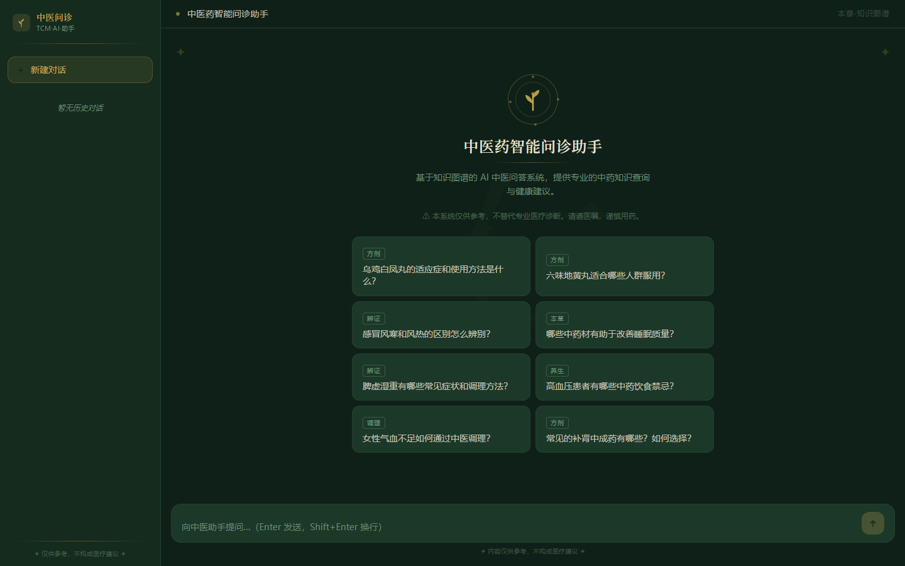
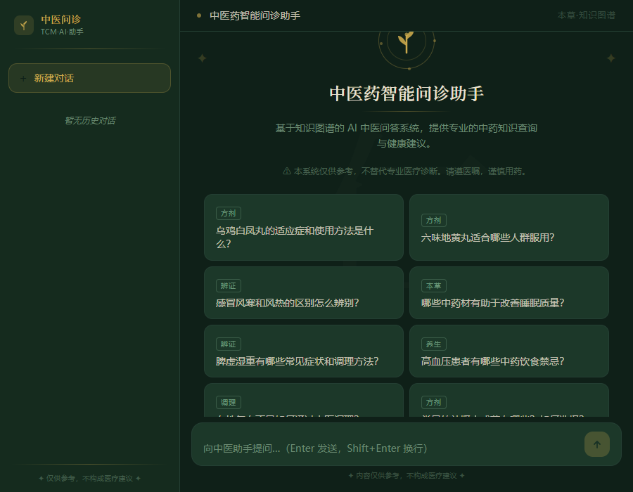
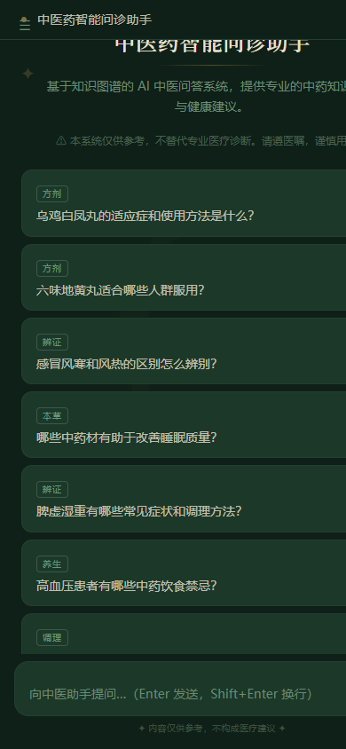

# 中医药智能问诊助手

> 基于知识图谱的 GraphRAG 中医药问答系统（TCM Intelligent Consultation System powered by Graph RAG）



---

## 目录

- [项目简介](#项目简介)
- [系统截图](#系统截图)
- [技术架构](#技术架构)
- [技术栈](#技术栈)
- [快速开始](#快速开始)
- [模块说明](#模块说明)
- [API 参考](#api-参考)
- [测试](#测试)
- [性能基准](#性能基准)
- [文档索引](#文档索引)

---

## 项目简介

本系统是一个面向**中医药知识查询**与**健康问诊**场景的 AI 问答平台，核心能力包括：

- **双向流检索架构**：按用户意图自动选择正向流（症状→寻药）或反向流（禁忌/条件查询）
- **知识图谱增强**：Neo4j 多跳子图富化，将药品实体、成分、功效、症状、人群等关系纳入上下文
- **混合召回**：Milvus 向量检索 + BM25 全语料稀疏检索，确保语义与关键词双路覆盖
- **充足性回环**：LLM 自动判断检索结果是否充分，不足则触发一次重检索
- **Token 级流式输出**：基于 `astream_events(v2)` 的 SSE 接口，前端实时渲染逐字输出
- **多轮会话**：SQLite 持久化会话历史，支持跨轮上下文记忆

---

## 系统截图

<table>
  <tr>
    <td align="center" width="60%">
      
      <br/><sub><b>桌面端 · 首页冷启动</b></sub>
    </td>
    <td align="center" width="40%">
      
      <br/><sub><b>平板端 · 侧边栏 + 话题入口</b></sub>
    </td>
  </tr>
  <tr>
    <td align="center" colspan="2">
      
      <br/><sub><b>移动端 · 响应式单列布局</b></sub>
    </td>
  </tr>
</table>

界面采用 **TCM 水墨金** 主题：深墨绿底色（`#0f2018`）× 朱砂金（`#c9a84c`）× 青瓷灰绿（`#7aab8a`），融入草叶 SVG 徽章、「仁」字水墨水印与本草分类标签。

---

## 技术架构

### 在线问答流程

```
用户提问
   │
   ▼
router_node ──────────────────────────────────────────┐
  │  4 类意图分类                                       │ iteration_count > max_iters
  │  coreference rewrite + 实体提取                     │ → 强制兜底
  ├── symptom_to_drug / theory ──► 正向流               │
  │      milvus_search_node                            │
  │        BM25 + Dense 混合检索                        │
  │      graph_enrich_node                             │
  │        kg_anchor_id 多跳子图富化                    │
  │                    │                               │
  └── conditions_exact ──► 反向流                       │
         neo4j_search_node                             │
           CAUTION_FOR / HAS_ADVERSE_REACTION Cypher   │
         milvus_fetch_node                             │
           node_id 标量点取                             │
                    │                                  │
                    ▼                                  │
              fuse_node (RRF)                          │
                    │                                  │
              rerank_node (CrossEncoder)               │
                    │                                  │
           sufficiency_node ◄─────────────────────────┘
             │    │
     sufficient  insufficient → 回环 Router（最多 1 次）
             │
        answer_node
          async astream + next_questions
             │
           SSE ──► 前端 token 级渲染
```

### 状态字段

| 字段 | 类型 | 说明 |
|------|------|------|
| `query` | `str` | 用户当前问题 |
| `routing` | `RoutingSignal` | 意图 + 复杂度 + 关键词 |
| `kg_anchor_id` | `str \| None` | 正向流：MilvusSearch→GraphEnrich 桥接 ID |
| `milvus_doc_ids` | `list[str]` | 反向流：Neo4jSearch→MilvusFetch 桥接 ID 列表 |
| `milvus_docs` | `list[Document]` | 向量/标量检索结果 |
| `graph_docs` | `list[Document]` | 图谱富化结果 |
| `docs_final` | `list[Document]` | 重排后最终上下文 |
| `sufficiency` | `sufficient \| insufficient` | 充足性判断结果 |
| `iteration_count` | `int` | 回环计数（阈值 1） |
| `answer` | `str` | 生成的回答 |
| `next_questions` | `list[str]` | AI 生成的追问建议 |
| `history` | `list[dict]` | 多轮对话历史 |

---

## 技术栈

| 类别 | 技术 |
|------|------|
| 工作流引擎 | LangGraph 1.x |
| 知识图谱 | Neo4j 5 |
| 向量数据库 | Milvus |
| 稀疏检索 | BM25 (rank-bm25) |
| 重排序 | CrossEncoder (BAAI/bge-reranker-base) |
| 大语言模型 | Moonshot / Kimi API |
| 嵌入模型 | BAAI/bge-small-zh-v1.5 |
| Web 框架 | FastAPI + SSE |
| 会话持久化 | SQLite |
| MCP 框架 | FastMCP |
| 前端 | Vite + React 18 + TypeScript + Tailwind CSS |
| 状态管理 | Zustand |
| 包管理 | uv (Python) / npm (Node.js) |

---

## 快速开始

### 1. 安装 Python 依赖

```bash
uv sync
```

### 2. 安装前端依赖

```bash
cd frontend && npm install
```

### 3. 配置环境变量

```bash
cp example.env .env
```

编辑 `.env`：

```bash
# Neo4j
NEO4J_URI=bolt://localhost:7687
NEO4J_USER=neo4j
NEO4J_PASSWORD=your_password
NEO4J_DATABASE=neo4j

# Milvus
MILVUS_URI=http://localhost:19530
MILVUS_COLLECTION_NAME=tcm_knowledge
MILVUS_HEALTH_COLLECTION_NAME=health_knowledge

# LLM（二选一）
MOONSHOT_API_KEY=sk-...
KIMI_API_KEY=sk-...

# 可选
FAST_MODE=false
FRONTEND_ORIGINS=http://localhost:5173
```

### 4. 启动服务

```bash
# 终端 1：后端
uv run uvicorn src.app.api_server:app --reload

# 终端 2：前端
cd frontend && npm run dev
```

访问 [http://localhost:5173](http://localhost:5173)

---

## 模块说明

### 离线构建

解析药品 NER 实体与中医文献，写入 Neo4j + Milvus：

```bash
uv run python -m src.app.offline_ingestion.cli data/ -o ./ai_output --resume
```

构建结果统计：
- Neo4j：节点数 / 关系数（按 `conceptType` 分布）
- Milvus `tcm_knowledge`：药品档案 + 中医文献
- Milvus `health_knowledge`：健康科普 QA

### 在线问答（CLI）

```bash
# 交互模式
uv run python -m src.app.online_qa.cli

# 单问流式
uv run python -m src.app.online_qa.cli --query "乌鸡白凤丸的适应症是什么？" --stream
```

### MCP Server（Trae 接入）

```bash
uv run python -m src.app.mcp_server
```

Trae 配置：

```json
{
  "mcpServers": {
    "tcm-assistant": {
      "command": "uv",
      "args": ["run", "python", "-m", "src.app.mcp_server"],
      "cwd": "D:\\CODE\\MedicalRAG\\GRAG-Agent"
    }
  }
}
```

### 数据层校验

```bash
uv run python -m scripts.verify_data_layer
# 生成 benchmark/data_layer_report.json
```

---

## API 参考

**基础 URL**：`http://localhost:8000`

| 方法 | 路径 | 说明 |
|------|------|------|
| `GET` | `/api/v1/health` | 健康检查 |
| `POST` | `/api/v1/qa/stream` | 流式问答（SSE） |
| `POST` | `/api/v1/qa` | 同步问答（兼容旧接口） |
| `GET` | `/api/v1/sessions` | 会话列表 |
| `DELETE` | `/api/v1/sessions/{id}` | 删除会话 |

**流式问答示例**：

```bash
curl -N -X POST http://localhost:8000/api/v1/qa/stream \
  -H "Content-Type: application/json" \
  -d '{"question": "六味地黄丸适合哪些人群？", "session_id": "demo-1"}'
```

SSE 事件流格式：

```
event: token
data: {"chunk": "六味"}

event: token
data: {"chunk": "地黄丸"}

event: suggest
data: {"questions": ["哪些人不适合服用？", "可以长期服用吗？", "有哪些替代药品？"]}

event: done
data: {"session_id": "demo-1", "trace_id": "..."}
```

---

## 测试

```bash
# 全量测试（122 个，全绿）
uv run python -m pytest tests/ -v

# 按模块运行
uv run python -m pytest tests/test_online_qa_graph.py -v   # 端到端图测试
uv run python -m pytest tests/online_qa/ -v                # Stage 2 节点
uv run python -m pytest tests/core/ -v                     # 数据层工具
uv run python -m pytest tests/test_api_server.py -v        # API 接口

# 前端单元测试
cd frontend && npm test
```

---

## 性能基准

```bash
python -m scripts.benchmark_online_qa \
  --queries-file scripts/benchmark_queries_task5.txt \
  --runs 1 \
  --p95-target 6.0 \
  --output benchmark/task5_benchmark_result.json
```

| 指标 | 数值（Stage 2 前基线） |
|------|------|
| 样本数 | 6 |
| 均值 | 6.082s |
| P50 | 5.507s |
| P95 | 8.715s |

---

## 文档索引

| 文档 | 说明 |
|------|------|
| [`CLAUDE.md`](CLAUDE.md) | 架构设计与开发规范 |
| [`PROCESS.md`](PROCESS.md) | 各阶段进度记录与测试结果 |
| [`docs/stage1_frontend_requirements.md`](docs/stage1_frontend_requirements.md) | Stage 1 前端需求 |
| [`docs/stage2_backend_requirements.md`](docs/stage2_backend_requirements.md) | Stage 2 后端需求 |
| [`docs/stage2_backend_design.md`](docs/stage2_backend_design.md) | Stage 2 后端设计 |
| [`docs/stage3_data_requirements.md`](docs/stage3_data_requirements.md) | Stage 3 数据层需求 |
| [`docs/stage3_data_design.md`](docs/stage3_data_design.md) | Stage 3 数据层设计 |

---

## 许可证

MIT License
