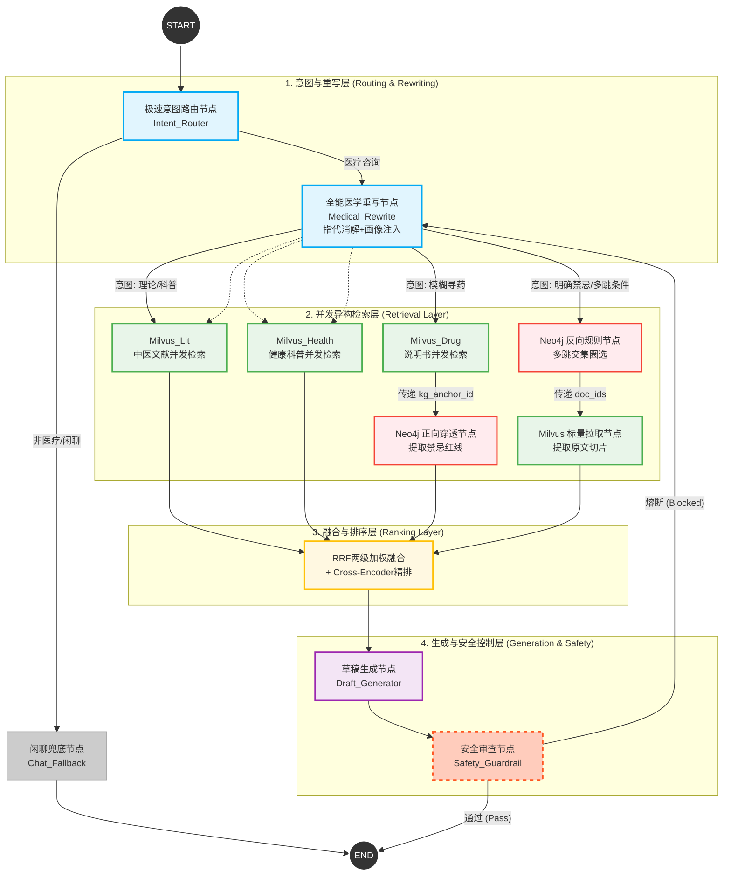

# Stage 2 Reference: Full Agentic Flow (supplementary)

> **注意**：本文档是用户提供的参考设计，仅供对照。Stage 2 实施以 `stage2_backend_design.md` 为准。

## 与原设计的关键 Delta

| 维度 | 原设计（authority） | 参考设计（reference） |
|---|---|---|
| 意图分类数 | 2 类（symptom_to_drug / conditions_exact） | 4 类（+ theory / chat） |
| 查询重写 | 无独立重写节点 | `Medical_Rewrite`（指代消解 + 画像注入） |
| 检索分支 | 症状→Milvus+GraphEnrich；禁忌→Neo4j+MilvusFetch | 理论分支仅 Lit+Health；症状分支 3 路 Milvus+Graph | 
| 充足性回环 | Router 回环（最多 1 次） | 无充足性回环；Safety 熔断后 → Rewrite |
| 安全审查 | 无独立 Safety 节点 | `Safety_Guardrail`（生成后） |
| 用户画像 | 无 | `user_profile` (SQLite 长期记忆) |
| 闲聊处理 | 无（所有 query 走医疗流程） | 独立 `Chat_Fallback` 分支 |

## Stage 2 实施中可低成本采纳的增量（不改主流程）

以下 3 点与原计划兼容，实施时直接加入：

1. **`rewritten_query` 字段** — 在 Router 内部追加一步 LLM prompt 做指代消解，结果写入 state，后续节点优先用 `rewritten_query`；原 `query` 保留供回溯。
2. **`extracted_entities` 字段** — Router 解析 JSON 时顺带提取药名/病名/症状锚点，不增加额外 LLM 调用。
3. **`safety_blocked` + `safety_reason`** — `answer_node` 生成后加一个轻量规则检查（十八反/十九畏关键词列表匹配），命中则设标志位并在回答前追加免责说明；不做回环。
